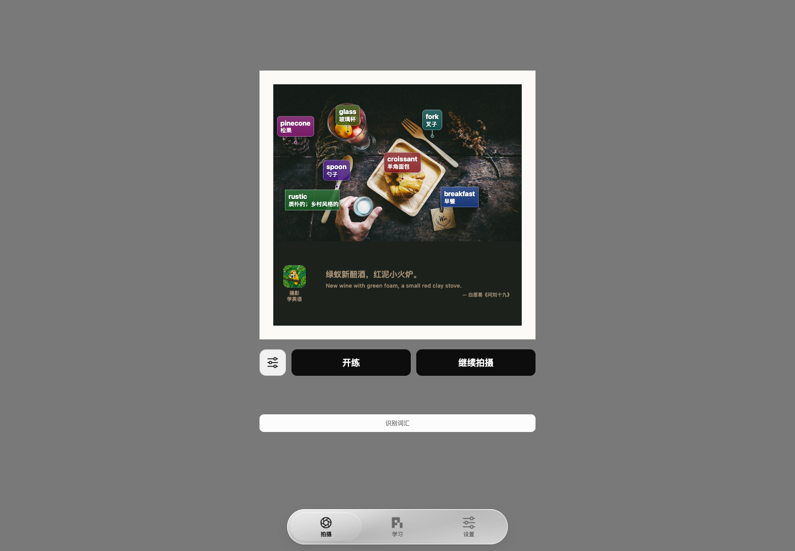
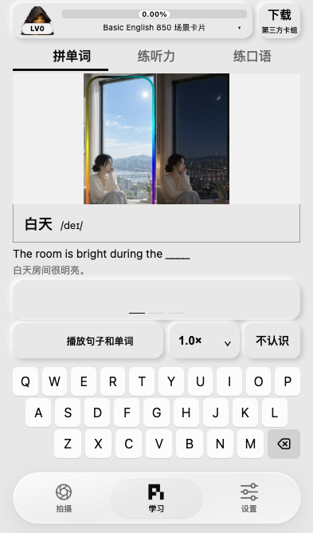
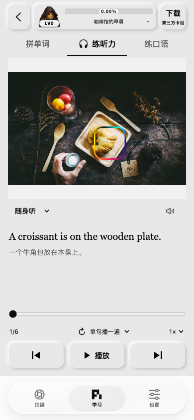
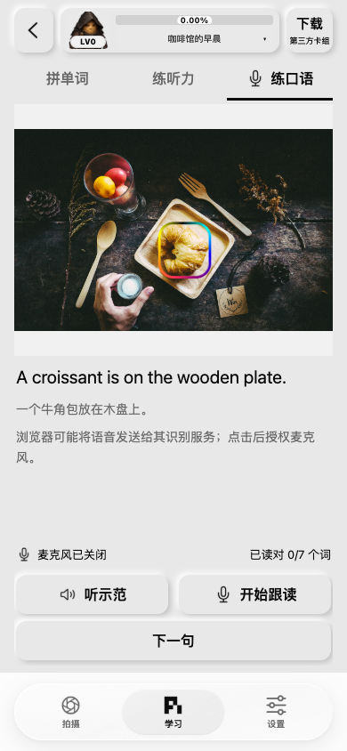
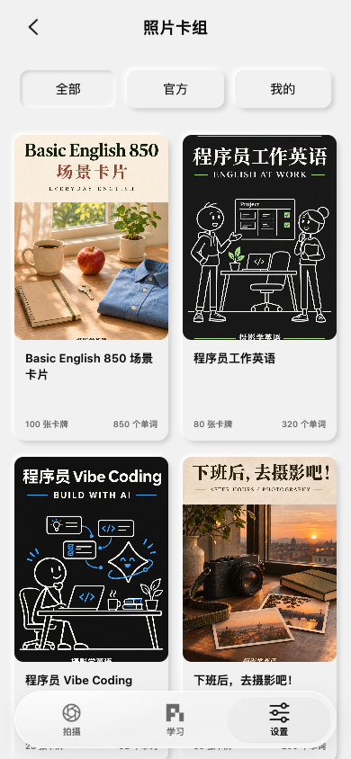
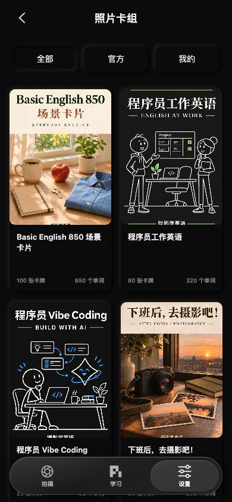
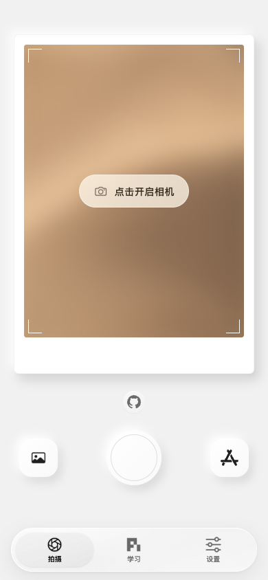
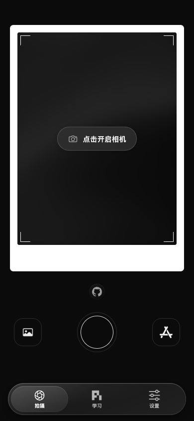

# 摄影学英语 Web

**把眼前的生活，变成英语。** 拍照制卡，用照片练拼写、听力和口语。打开浏览器即可开始，无需登录。

[在线体验](https://piclex.v2fy.com/piclex-web/) · [GitHub Pages 镜像](https://zhaoolee.com/piclex-web/) · [iPhone App](https://apps.apple.com/app/id6808490052)

## 一张照片，就是一页英语

拍摄或导入 → 双语标签与场景例句 → 开始练习。

<p align="center">
  
</p>

本页均为 Web 界面截图，摄于 2026-11-04～05。

## 看图拼词，听句子，开口说

<table>
  <tr><th>拼单词</th><th>练听力</th><th>练口语</th></tr>
  <tr>
    <td></td>
    <td></td>
    <td></td>
  </tr>
</table>

## 选一套喜欢的卡组

日常生活、程序员英语、摄影……也能导入自己的 `.piclexdeck`，或分享公开卡组的练习链接。

<table>
  <tr><th>浅色卡组</th><th>深色卡组</th></tr>
  <tr>
    <td></td>
    <td></td>
  </tr>
</table>

## 白天、夜晚，都有喜欢的样子

浅色、深色、自定义配色，搭配喜欢的键盘音。

<table>
  <tr><th>浅色相机</th><th>深色相机</th></tr>
  <tr>
    <td></td>
    <td></td>
  </tr>
</table>

进度与导入内容保存在当前浏览器，不跨浏览器或 App 自动同步。AI 制卡会将照片发送给所选服务；自带 Key 保存在浏览器且未加密。相机和语音功能依赖浏览器支持与授权。

## Docker 一键启动

```sh
docker run -d --name piclex-web \
  --restart unless-stopped -p 127.0.0.1:18120:8080 \
  zhaoolee/piclex-web:latest
```

打开 <http://127.0.0.1:18120>。照片和进度保存在浏览器；自托管 AI 制卡需配置自己的模型。[Compose、HTTPS 与更新说明](docs/docker.md)。

[使用与开发说明](docs/web-guide.md) · [发布自己的卡组](docs/publishing-decks.md) · [部署说明](deploy/README.md) · [二维码分享封面](docs/subscription-qr/README.md)

代码使用 [MIT](LICENSE)；卡组内容按原来源授权，详见[素材说明](ASSET_LICENSES.md)。
