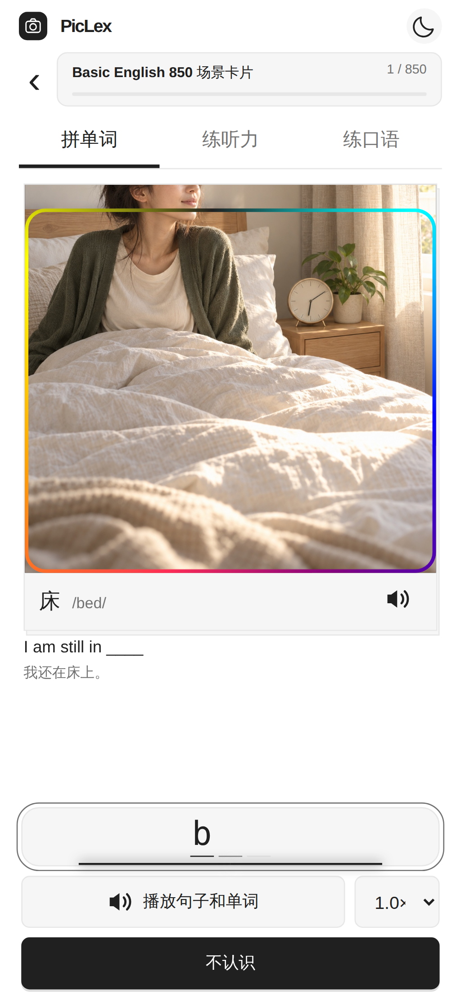
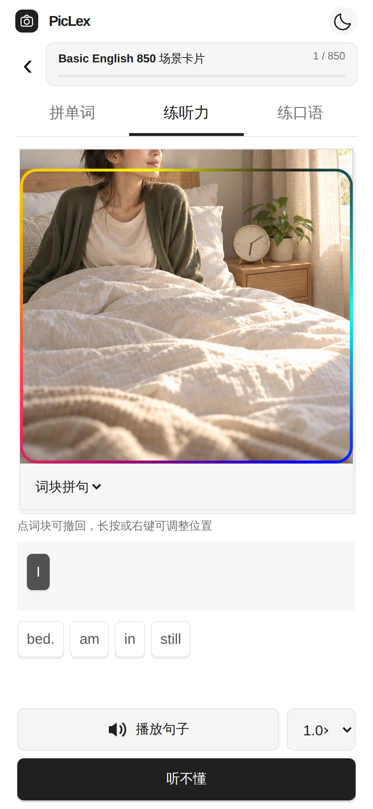

# Web 学习页与移动端对齐

基线为 PicLex 主目录 2026-11-03 的 `PracticeView.swift`、`PracticeScreenLayout.swift`、`PracticeDeck.swift`、`PracticeSpellingGlow.swift`、`SentenceDictation.swift` 和 `SentenceDictationView.swift`。没有把较旧的局域网页面当成当前 App 的完整实现。

| 移动端约定 | Web 实现 |
| --- | --- |
| 卡组进度 → 拼单词 / 练听力 / 练口语 → 照片 → 输入与操作 | 单列学习屏，桌面保持同一顺序；浏览器可视区变化时始终为网页键盘与操作区保留空间；支持标签与横滑切换 |
| 照片局部聚焦与彩框 | 原有 `PracticeFocusGeometry` 对应算法，3px 彩色边框、5秒流动，同图位置变化0.5秒；无有效可见区域的词展示整图，不伪造框 |
| 照片浏览 | 点照片或双指触碰打开照片选择；返回同题不丢草稿；切题取消旧的自动前进 |
| 拼词 | 固定分隔符、错字阻断、退格修正、字母局部反馈、输入轮廓光、答对300ms自动下一词、不认识后手动下一词 |
| 快拼 | 本浏览器错误字母位置补练，下一题跳过已掌握词；未有错字记录时完整输入 |
| 例句 / 播放 | 目标词遮罩、中文提示开关、英语音标、例句先于单词播放、0.75/0.85/1/1.15倍速；准备／播放／重播共用原按钮，进度填充在按钮内，右侧只保留倍速 |
| 练听力 | 顺序为随身听、词块拼句、自由听写；首次默认词块，记住选择；当前词进入、走到末尾，不循环移到队首 |
| 词块拼句 | 重复词块独立身份、乱序词库、点击选入/撤回、长按/右键调整顺序、Alt+左右键调整、填满自动检查、错序可修改 |
| 自由听写 | 三档提示、大小写与标点归一、缩略形式等价但保留否定语义；正确自动判断，错词/漏词/多词反馈；显示答案后可重新拼写 |
| 句子结果 | 每种模式独立草稿和结果；成功1秒后前进（减少动态效果450ms）；听不懂为参考答案，不计正确；切换模式/照片/后台使旧回调失效 |
| 随身听 | 单句五遍/一遍/快3慢2/单句循环、单图一句、前后句、播放暂停、逐词位置选择、后台停止 |
| 口语 | 听示范、浏览器支持时主动授权麦克风跟读、识别单词匹配着色；不生成虚假发音评分 |
| 卡组内容与进度 | 保留新概念427个原始句子 occurrence ID；五套公开内容与本地导入通用；旧Web拼词进度迁移到v2，原记录不删除 |

## 浏览器与 iOS 的边界

- 发音与跟读使用浏览器提供的语音能力，音色、逐词事件、识别可用性受浏览器影响。识别可能使用浏览器供应商的服务；只在访问者主动点击后请求麦克风。没有识别能力的浏览器仍能听示范和自行跟读。
- 浏览器播放位置是按词重新朗读，不能冒充 iOS 音频文件的毫秒级 seek 或后台锁屏播放器。
- 长句词块使用原生算法的确定性词性规则与动态规划代价；浏览器没有 Apple `NLTagger`，个别长句边界可能不同。短句、一致性、重复词、原生示例与判题规则有回归覆盖。句子切分采用浏览器 `Intl.Segmenter`，带 occurrence ID 的原始单句不再拆分。
- iOS 账户与设备数据不自动同步。Web 等级独立保存在 IndexedDB，使用相同公式与计分规则；FSRS、系统触感、闭眼语音拼字及环境音仍由 App 提供。拍摄页可选取照片手动制卡，公开站不暴露私有识别接口。
- 同一源文件的原始提取指纹仍见 `extracted-files.json`；后续 Web 适配已明确记录在这里，不能再把改过的文件当作逐字复制。

## 发布验收

最终源码 `209bd95` 已通过37项逻辑测试、8项部署测试与16条桌面/手机浏览器流程；两个公开域名已同步。完整证据见[验收报告](reports/2026-11-03-native-learning-verification.json)。

## 三栏、输入反馈、等级和实验室

底部顺序与 `PicLexApp.swift` 一致：拍摄、学习、设置。学习内仍为拼单词、练听力、练口语。原卡组深链接继续可用；回到学习恢复上次卡组。

粒子参数来自 `PracticeExperience.swift`，采用下喷、底部转向、照片两侧上升和经验条吸入路径；恢复旧答案、预填和揭晓不重放。字符波纹沿用 App 的0.7秒反馈。等级 LVn 门槛为 n(n+1)；拼词1经验、句子3–6、跟读按匹配补足。事务锁与稳定事件标识保证多标签页不重复入账、游戏不超支。不同域名、设备与 App 的进度独立。

`packages/laboratory` 复用 App 当前 `local-web/src/lab` 的游戏引擎、存档和美术；浏览器适配仅替换词库、经验和退出桥。练习选中的卡组供游戏使用，继续旧存档沿用该局词库。实验室采用横屏布局。经典按键音复用 App 原资源，默认开启；LV3 只解锁更多选项，不能限制基础声音；浏览器声音受系统音量与自动播放规则控制。

## 图标与宽窄屏

品牌 PNG 与 App 原图一致，底部光圈、方块 P、滑杆直接由生产 `PracticeEntryIcon.swift` 绘制导出，点击动画分别为0.66／0.72／0.5秒；减少动态效果时显示静态帧。学习页喇叭、返回、关闭、设置箭头等由同一 UIKit/SF Symbols 来源导出，通过透明蒙版跟随主题。导出脚本为 `scripts/export-native-icons.swift`，来源摘要与资源指纹见 `native-icons.json`；后续应从 App 同步导出，不另画 Web 专用变体。

320／390像素保持单列，768像素卡组两列，1440像素卡组三列、设置同级分区两列；制卡选择照片后，宽屏照片和编辑区并排。所有宽度共享原 DOM、三个 Tab 和学习顺序。学习控件以动态可视高度布局，矮屏缩减照片与可滚动正文，底部导航不覆盖主要按钮。已删除重复的宣传页脚。

## 手机学习结构与 PC 键盘

按当前生产 `PracticeProgressBattery.swift` 的50点顶部面板合并头像、等级经验和卡组入口，使用同一张游戏 `hero.png`、1.8倍头像缩放及等级标签。学习页不再叠加网站导航，保留 App 的模块栏、照片／释义、例句、50点拼写板、播放与主要按钮顺序；PC 主体限宽460像素，按剩余高度缩照片，键盘接在答案操作下方。选中模块显示 App 对应 a.square／耳机／麦克风图标。

所有设备显示可点击 QWERTY 键盘，实体键盘与虚拟键盘共用受控输入路径并同步键帽高亮，不重复提交文字。拼词空格播放，Esc揭晓、回车继续；自由听写支持选择区替换、退格、数字／符号，简单模式逐词移焦。词块拼句与口语不显示无用键盘。失焦、切页或打开弹窗清理按键状态，减少动态效果仍有效。

按2026-11-04最新要求，拼单词与自由听写三个难度均显示网页键盘，输入字段从挂载起保持只读与inputmode=none，禁止系统键盘随聚焦弹出。网页按键、外接实体键盘通过原拼写状态机输入；下一词、弹窗返回、刷新均保留保护。自由听写不再使用系统键盘。键盘与答题操作始终位于底部导航上方；空间不足时只滚动照片／题目区域，并将当前听写字段滚动到该区域内。提示条位于页面顶部。手机检查使用触摸浏览器仿真，不冒充真机Safari人工验收。

商店入口改为 Apple 官方黑色英文 Download on the App Store 徽章；保留原商店链接和可访问名称，素材说明记录官方来源。

## 播放状态按原生交互验收（2026-11-04）

`SpellingSentencePlaybackControls` 与 `SentenceDictationView.controls` 都在原播放按钮内显示进度，点击原按钮重播，右侧只有倍速。本轮删除 Web 额外增加的停止按钮，补齐准备状态、按钮内进度、自然结束／失败／离页清理，以及旧回调隔离。以后不能只验收静态布局、播放顺序或按钮能否点击；必须覆盖准备、播放中、重播、结束、失败与切页状态，并核对按钮布局稳定。

原音频的段内进度来自 `currentTime / duration`；浏览器 TTS 无可靠总时长，按真实字符边界与各段文本长度显示整段队列进度，不声称是毫秒级时间进度。不提供边界事件的语音仅显示按钮内播放动效，不伪造百分比；减少动态效果时保留静态提示。歌曲原声不伪造逐词高亮。只有进度装饰订阅音频时钟，避免原音频每次 timeupdate 重建拼写输入。

浏览器行为回归在桌面 Chrome、触摸 Chrome 与 WebKit 中验证原按钮尺寸不变、没有停止按钮、播放中可拼写、句子后接单词、重播与改倍速从头开始、结束／错误／切模式／pagehide 清理，以及无边界事件与减少动态效果。原唱音频另有真实解码与播放进度回归；浏览器仿真不等于真实 iPhone/Safari 人工验收。

## 2026-11-04 状态核对与回归范围

对照当前 App 的 PracticeView、SentenceDictationView、ReadingOverlay、ShutterSoundPlayer、PolaroidCaptureOverlay；Web 状态与资源变更如下。验证是本机真实浏览器引擎与受控输入，不冒充真实 iPhone 人工验收。

| 路径 | 修复与验收状态 |
| --- | --- |
| 播放按钮 | 准备、按钮内进度、重播、倍速、结束、失败、过期回调、切模块和后台停止；没有独立停止按钮 |
| 基础按键音 | 默认经典音开启，LV0 实体键、触摸键、退格和听写三档均能发声；手动静音刷新后保留。LV3 仅是更多选项门槛，Web 暂未新增其他音色 |
| 拼词/听写 | 不认识/听不懂播放答案；下一题按 App 播放提示；点当前模块/模式不打断；正确后重播取消自动跳题 |
| 随身听 | 原声依据真实 duration/currentTime 拖动、暂停及续播；TTS 仍按词定位，不伪造音频时间 |
| 口语 | 听示范前释放麦克风，开始跟读停止示范；部分识别累积到目标位置，全绿后停止麦克风并在1秒后接下一句；末尾保持口语模块，不写入拼词成绩；首次仍显式授权浏览器麦克风 |
| 相机照片 | 根据实际预览中心 cover 范围裁剪，再编码/识别/保存；横、竖视频源分别核对四角及中心色块、输出比例和保存尺寸，避免预览竖幅而照片横幅 |
| 快门反馈 | App 原版 Minolta 音频只在有效快门按下时播放一次，打开相机/导入不触发；浏览器真实 playing 事件验收，失败不丢照片 |
| 出片槽与相纸 | 原生胶囊描边、后壳/纸/前盖遮挡顺序；按下快门立即黑幕并横向展开0.30秒、纵向0.18秒，编码未结束也先展开；收到照片后快送白边、3.8秒匀速送片、释放/显影/整纸归位；关闭保留后台识别 |
| 实验室加载 | 首屏即有加载状态；下载阶段按实际流字节与构建大小显示比例，图片按实际完成数显示；慢网、半包、失败重试、离开与已有游戏存档均覆盖 |
| 原有捕获流程 | 导入、识别失败、额度不足、保存重试、跨页后台完成、连续照片、手动编辑、倒计时取消与减少动态效果回归 |

浏览器边界：页面无法操控 iOS 系统灵动岛；出片槽在网页自身视口使用同一几何/分层模型，有安全区时沿用 App 胶囊位置，无安全区时使用 App 普通屏幕布局。TTS 的边界事件、语音识别可用性和系统播放许可由浏览器提供；缺失时提供真实状态，不虚构进度或发音评分。硬件触觉与系统后台能力未声称对齐。

## 相机表面与生成卡片（2026-11-04）

- 空取景框删除首次授权说明。按用户最新纠正使用香槟金、暖金、琥珀金动态渐变叠加38px高斯模糊及28px毛玻璃，裁剪在照片矩形内；切页暂停，减少动态效果时静止。实际授权仍走浏览器权限提示。
- 右侧附件入口按用户最新纠正仅保留透明的三个圆头棍形A标记，无图标底色/外框，标准链接target=_blank、noopener noreferrer指向摄影学英语id6808490052。桌面/触摸Chrome验收真实目标URL和新标签；本机WebKit会把apps.apple.com交给系统商店，自动化先核对真实href，再用拦截的中性域名单独验证新标签和opener隔离，不把它记作Safari真实商店页面验收。
- 底部导航去掉上边线及阴影，使用主题背景混色区分区域，浅色/深色均核对无边线。
- 生成卡片对照CapturePolaroidPaperSurface、ImagePipeline/PosterRenderer及StoredCardImageView：奶油色直角相纸、5%白边、34%照片宽度的页脚，使用App实际BrandLogo和两行品牌字。照片配色页脚、引文位置及中英文字级沿用原生比例。
- 标签按原生1000px参考尺寸统一排版再整体缩放，避免系统字体在小字号下光学尺寸变化造成截断。复用色相分离、白字玻璃色对比、目标避让/标签排布、白边彩色连接线和目标点；可见物体与场景联想使用相应圆角/直角，保留点击定位。按App一秒平滑曲线从目标展开并淡入，全部完成后再开始进入练习倒计时。保存包保留解析后的固定颜色，避免下次打开重新配色。
- 浏览器图形合成和字体栅格化仍由各引擎执行；本轮是原生参数及交互状态对齐，不声称与iOS离屏渲染逐像素相同。未启动模拟器或更改手机数据。
