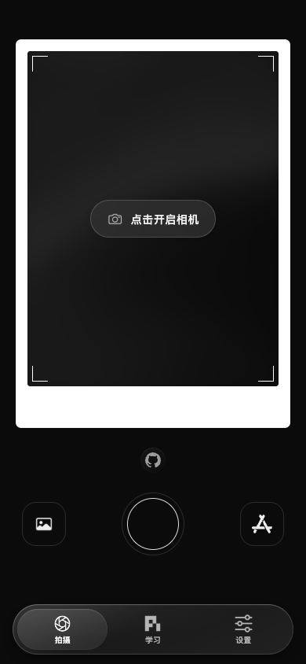
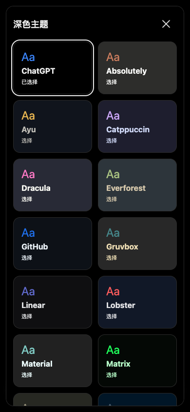

# 摄影学英语 Web · 使用与开发说明

[返回项目首页](../README.md)

## 可以做什么

- **拍照制卡**：开启相机或导入照片，自动识别词汇、生成例句和照片卡片；保留出片动画、识别进度、失败重试和手动修改。卡片保存后可直接进入拼写。
- **照片学英语**：拼单词、词块拼句、三档自由听写、随身听和口语跟读。照片定位框、逐字纠错、正确反馈与经验粒子跟随练习；各卡组分别保留进度和草稿。
- **分享当前练习**：切换拼单词、练听力、练口语，或翻图、换词、换句时，地址栏会同步当前位置；直接复制链接，或点照片打开图库后选择分享。公开卡组链接可在其他浏览器定位同一内容，听写难度也会保留；不传递答题记录或经验。本地卡组通过 `.piclexdeck` 文件分享。
- **可点击的网页键盘**：手机和桌面都能使用，支持实体键盘；拼词退格键在键盘右下角，听写键盘提供空格、符号和回车。浏览器支持的语音识别可用于跟读。
- **下载第三方卡组**：学习页右上角打开「下载第三方卡组」，粘贴公开 HTTPS 卡组或订阅清单 URL；下载时验证内容，重复包显示「已下载」。也可以导入 App 或 Studio 导出的 `.piclexdeck` 文件。
- **与 App 对应的设置**：设置首页使用等级卡、官方卡组横向展示和统一的单列入口。查看学习等级会打开弹层，关闭后仍在原题。
- **主题与声音**：内置主题提供 16 种浅色、28 种深色选择，分别记住主题和强调色；支持自定义配色。14 种原生自定义键盘音可试听，Web 默认 Cherry MX Blue；提供 3 种快门录音及浏览器朗读声音选择。
- **更多练习方式**：LV6 快拼、LV7 粒子效果；「设置 → 个性化设置 → 实验室」可以玩薯薯求生，学习与游戏共用经验。更多键盘音、快门音分别在 LV3、LV4 解锁。

底部采用浮动玻璃导航，支持点击、拖动选择和键盘操作。拍摄背景在浅色下为柔和金色沙丘，深色下为黑色沙丘；支持减少动态效果。快门上方的小章鱼会在新标签页打开本仓库。

<details>
<summary>查看深色拍摄与主题选择</summary>

<table>
  <tr>
    <td></td>
    <td></td>
  </tr>
</table>

</details>

## 开箱即用的公开卡组

目前内置 6 套公开卡组：Basic English 850、程序员工作英语、程序员 Vibe Coding、下班后去摄影、新概念英语第二册、经典英语歌曲。当前快照共 **360 张照片卡、2,042 个词条**。

练习时按需加载词条、照片和声音，不必先下载完整卡组。歌曲卡组当前为 V8，含 22 张场景卡、153 句歌词，例句优先使用卡组原声，单词使用英文朗读。公开卡组可分享独立链接，也可下载后在 App 中打开。

卡组支持独立的横版与竖版封面。封面不参与学习内容指纹，换封面不会重置练习进度。内容格式见 [卡组来源协议](../docs/deck-source-protocol.md)。

## 数据与平台边界

- 学习进度、导入卡组和设置保存在当前浏览器；刷新可继续学习。不同域名、浏览器与 iPhone App 之间**不会自动同步**。
- 导入 `.piclexdeck` 在本地解析，不上传卡组。**拍摄或导入单张图片发起 AI 制卡时，会使用 AI 配置中选择的服务**。官方模型无需 Key，受每日额度限制；自定义模型可分别配置 DeepSeek 或 OpenAI 兼容服务的 Base URL、图片模型名称和 API Key，照片直连该服务，不占官方额度。
- Web 是静态前端；公开卡组学习和本地文件导入可独立使用，AI 制卡依赖所选模型服务。自定义服务须允许浏览器跨域请求；配置自动保存在当前浏览器，API Key 未加密且不随照片备份导出。本机模型尚未接入 Web。浏览器朗读、语音识别和相机能力随设备与授权情况变化，不能保证与 iOS 完全相同的音色或硬件能力。
- 学习卡组导入单包上限 64 MB，解压后上限 96 MB，最多 500 张照片、5,000 个词条。卡组图片支持 JPEG、PNG；HEIC/HEIF 请先在 App 或 Studio 中转换。
- 文件导入校验失败不会覆盖已有卡组。清理站点数据或浏览器回收存储可能移除本地内容，请保留原始文件或导出卡组。
- 第三方下载需要来源允许浏览器跨域访问。目前尚未提供订阅自动更新或购买权益；学习目标、每日统计、闭眼记单词等 App 功能也仍待移植。当前核对范围见 [Web/App 对齐记录](../docs/reports/2026-11-04-web-app-parity-audit.json)。
- 仓库源码不内置统计 SDK；当前独立域名由 Cloudflare 注入访问统计脚本。GitHub Stars 和访问量不代表实际 App 转化。

## 本地运行

需要 Node.js 22.12+，依赖由 `package-lock.json` 固定。

```sh
npm ci
npm run content:build
npm run dev
```

打开终端给出的地址，默认是 `http://127.0.0.1:18120/piclex-web/`。

```sh
npm test                         # 状态机、解析、完整性与交互规则
npm run test:deploy               # 部署脚本检查
npm run build                    # TypeScript + dist/ 静态产物
npx playwright install chrome webkit
npm run test:browser              # 构建后运行桌面/手机 Chrome、移动 WebKit 回归
npm run preview                  # 本地预览构建结果
```

`content/snapshot.json` 固定公开来源、卡组 ID、版本、大小和 SHA256。内容构建下载并校验这些公开文件，生成被 Git 忽略的 `apps/public/public/library/` 和来源清单；原始大包不提交到源码仓库。三个小型照片示例保留在 `tests/fixtures/demo/`，通过 `npm run decks:build` 重建。

## 目录

```text
apps/public/              Web 入口、拍摄、学习、设置和浏览器存储
apps/lan/                 局域网前端迁移说明
packages/learning-ui/     照片定位、拼写、键盘、反馈与声音
packages/practice/        练习状态机、进度和经验规则
packages/deck-format/     卡组读取、内容与哈希校验
packages/subscription/    订阅分享封面工具
```

复用来源见 [extracted-files.json](../docs/extracted-files.json)，迁移背景见 [迁移说明](../docs/migration.md)。手机局域网前端仍在 PicLex 仓库维护。

## 发布与第三方卡组

`dist/` 可部署到 GitHub Pages 或其他静态托管。两个公开入口统一使用 `/piclex-web/` 和 hash 路由；GitHub Actions 负责校验、构建、浏览器回归及 Pages 发布。独立域名的验收与回滚见 [部署说明](../deploy/README.md)。Fork 后请检查内容来源、使用范围和产品链接。

[公开来源清单](https://piclex.v2fy.com/piclex-web/source.json)采用 `com.piclex.deck-source` v1；公开构建不包含付费卡组。

要发布自己的卡组，请阅读 [完整发布指南](../docs/publishing-decks.md)，其中包含包格式、JSON Schema、校验工具和 HTTPS 托管要求。二维码直接编码普通订阅 URL，可由 App「下载第三方卡组」中的扫描窗口识别。

[在线制作二维码分享封面](https://piclex.v2fy.com/piclex-web/subscribe/) · [示例分享封面](../docs/subscription-qr/README.md)

## 许可

代码与原创界面文案使用 [MIT](../LICENSE)。卡组的文字、图片、声音不因公开访问而改为 MIT，权利以原来源为准；图标、录音和测试图片来源见 [素材说明](../ASSET_LICENSES.md)。

### 照片完整备份

“设置 → 照片数据 → 数据备份与恢复”支持本地 ZIP／备份文件夹及 WebDAV，与 App 共用照片和学习进度格式。照片归档及解压内容分别上限 **20 GiB（界面显示20 GB）**；学习进度 JSON 仍为 App 的 **64 MiB**，不是照片容量限制。ZIP64 支持超过4 GiB的归档。

传输、SHA-256、解压和打包按块处理，使用浏览器私有文件存储（OPFS），照片仅在 IndexedDB 中保存文件引用；刷新后仍可读取。恢复先验证再合并，保留已有照片与较新的学习进度。临时文件在完成／取消／失败后清理；本地导出保留最终下载文件，24小时后可在下一次备份操作清理，已保存照片不会被清理。

请使用支持 OPFS 的普通浏览器窗口，并预留足够磁盘空间（恢复和重新打包需要中间文件空间）。20 GiB 是应用上限，实际可用空间还受浏览器配额和设备空间影响；WebDAV 服务器需支持 HTTPS、CORS 和相应文件容量。传输时保持页面打开。无痕窗口可能不提供 OPFS 或限制容量。

测试：`npm run build && npx playwright test tests/browser/webdav-backup.spec.ts tests/browser/large-backup.spec.ts`。大文件默认约132 MiB；设置 `PICLEX_LARGE_TEST_MIB=5120` 可生成约5 GiB的合成照片备份，执行真实本地 HTTPS 上传、读回校验、恢复及重复恢复。测试不使用用户照片或真实 WebDAV 账号。可用 `PICLEX_NATIVE_ZIP_CHECK` 指定基于 App 相同 ZIPFoundation 版本的独立校验可执行文件。
